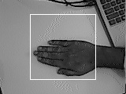

## Description

This tool visualizes camera images streamed from an embedded device over the **J-Link debug interface**. It opens a live preview window, draws the model **target region** on each frame, and optionally saves captured frames as JPEG files. A serial connection monitors the device VCOM log for application startup and errors.

The tool is implemented in `main.py`.

### Tool location

In SDK `aiml-extension`, `/tool/image-visualization`

## Initial setup

1. Install **Simplicity Commander**, then add the install directory to your system **Path** so the tool can load `jlinkarm.dll` / `JLink_x64.dll` at runtime.

   - **Windows :** Add:
     ```
     C:\Users\<user>\.silabs\slt\installs\archive\Simplicity Commander
     ```
     Replace `<user>` with your Windows account name.

   - **Windows (system settings):**  Settings → System → About → Advanced system settings → Environment Variables → System variables → select Path variable → New → add the Simplicity Commander directory above.

   - **Linux / macOS:** Add the Simplicity Commander install directory to `PATH` (for example in `~/.bashrc` or `~/.zshrc`: `export PATH="<install-dir>:$PATH"`), then open a new shell or `source` that file.

   Download: [Simplicity Commander](https://www.silabs.com/software-and-tools/simplicity-studio/simplicity-commander?tab=getting-started) and install, if not installed already.

2. Create a Python virtual environment:

```console
python -m venv .venv
```

3. Activate the virtual environment:

```console
.venv\Scripts\activate
```

4. Install required packages:

```console
pip install -r requirements.txt
```

## Usage

In SDK `aiml-extension`, from `/tool/image-visualization`:

```console
python main.py [options]
```

### Options

| Option | Description | Default |
| ------ | ----------- | ------- |
| `--camera-resolution` | Sensor resolution as `WidthxHeightxBytesPerPixel` (1 = grayscale, 2 = RGB565) | `96x96x2` |
| `--target-shape` | Model input region as `WidthxHeight` (drawn on preview) | `84x84` |
| `--save` | Save each captured frame as a JPEG under `--out-dir` | off |
| `--out-dir` | Directory for saved images (removed and recreated when `--save` is used) | `./dump_images` |
| `--port` | Serial port for device logs (VCOM) | `regex:JLink CDC UART Port` |

### Examples

Live preview only (default resolution and target shape):

```console
python main.py
```

Preview with explicit resolution and target region:

```console
python main.py --camera-resolution 96x96x2 --target-shape 84x84
```

Save frames to disk:

```console
python main.py --save --out-dir ./dump_images
```

## Workflow

1. Flash and run the image classifier firmware on the development board.
2. In SDK `aiml-extension`, start this tool from `/tool/image-visualization`.
3. The tool connects to the J-Link image stream and opens the **Development Board Samples** preview window.
4. The serial reader waits until the firmware prints a line matching `Image Classifier`, then keeps monitoring for hardfault / assert / error messages.

Press **Ctrl+C** to stop streaming and exit.

## Note

Keep the hand gesture inside the target rectangle shown on the preview. See `sample.jpg` for an example.


